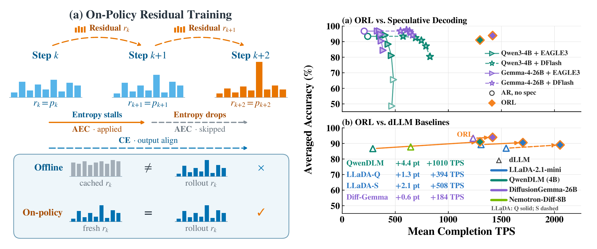
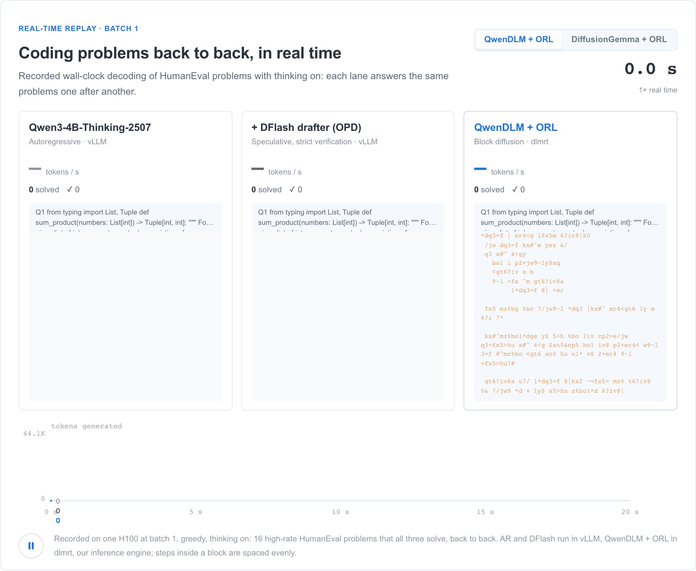
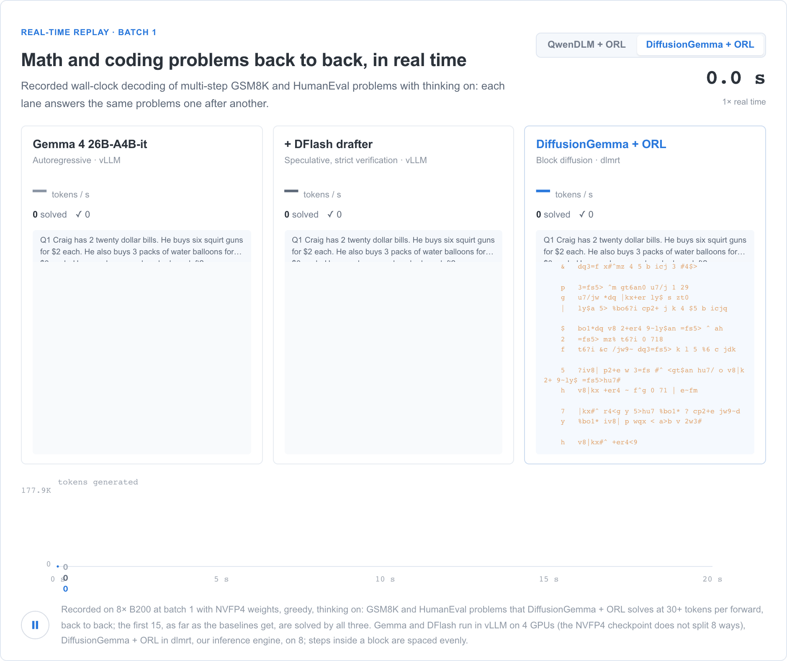
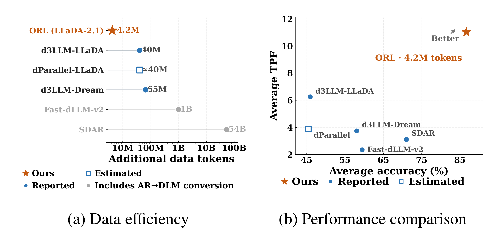
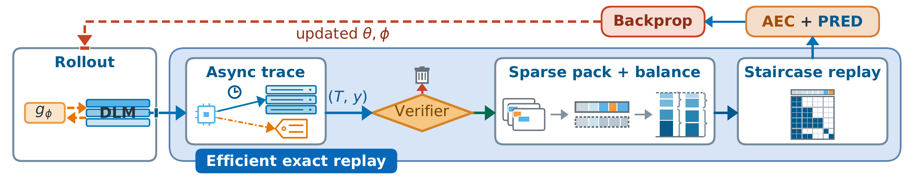
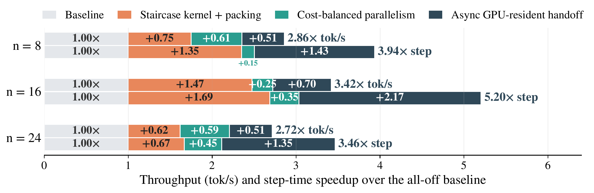

# ORL: On-Policy Residual Learning for Diffusion Language Models

<p align="center">
  Yifan Yu<sup>1,2,*</sup>, Yuqing Jian<sup>1,*</sup>, Jisen Li<sup>1,*</sup>, Yuezhou Hu<sup>3</sup>, Tianyi Zhang<sup>1</sup>,
  Xiaoxia Wu<sup>1</sup>, Rui-Jie Zhu<sup>4</sup>, Junxiong Wang<sup>1</sup>, Zhongzhu Zhou<sup>1,†</sup>, Fan Lai<sup>2,†,‡</sup>,
  James Zou<sup>1,5,†</sup>, Chenfeng Xu<sup>1,6,†,‡</sup>
  <br>
  <sup>1</sup>Together AI &nbsp; <sup>2</sup>University of Illinois Urbana-Champaign &nbsp;
  <sup>3</sup>University of California, Berkeley &nbsp; <sup>4</sup>University of California, Santa Cruz &nbsp;
  <sup>5</sup>Stanford University &nbsp; <sup>6</sup>The University of Texas at Austin
  <br>
  <sup>*</sup>Equal contribution &nbsp; <sup>†</sup>Equal advising &nbsp; <sup>‡</sup>Corresponding authors
</p>

<!-- To update once the paper is on arXiv: the arXiv badge and the BibTeX url. -->

<p align="center">
  
  <a href="https://introspective-diffusion.github.io/orl-dlm/"></a>
  <a href="#model-zoo"></a>
  <a href="https://github.com/Introspective-Diffusion/DLMRT"></a>
</p>

**ORL trains a diffusion language model on its own residual trajectories. On QwenDLM (4B) it raises tokens per forward
by up to 6.2× and end-to-end throughput by about 5× (about 6.9× together with dlmrt) at comparable or better quality,
and it improves LLaDA-2.1-mini and DiffusionGemma the same way.**

<p align="center">
  
</p>

<details open>
  <summary><b>Demo: Real-Time Single-Request Decoding</b></summary>

<p align="center">
  
</p>

  <p align="center"><i>QwenDLM + ORL against Qwen3-4B-Thinking-2507 (autoregressive) and the same model with a DFlash
  drafter, answering HumanEval problems back to back in real time.</i></p>

<p align="center">
  
</p>

  <p align="center"><i>DiffusionGemma + ORL against Gemma 4 26B-A4B-it and its DFlash variant on GSM8K and HumanEval
  problems.</i></p>

  <p align="center"><i>Both ORL models run in <a href="https://github.com/Introspective-Diffusion/DLMRT">dlmrt</a>, our inference engine. The
  <a href="https://introspective-diffusion.github.io/orl-dlm/#demo">project page</a> plays the same recordings interactively, and
  its <a href="https://introspective-diffusion.github.io/orl-dlm/#explorer">forward-pass explorer</a> steps through one GSM8K
  problem decoded three ways under the same forward-pass budget.</i></p>
</details>

---

## News

- **2026-10**: Real-time demo on the [project page](https://introspective-diffusion.github.io/orl-dlm/#demo), recorded with our
  inference engine [dlmrt](https://github.com/Introspective-Diffusion/DLMRT).
- **2026-10**: Code release: the offline training of QwenDLM-4B, ORL training recipes for QwenDLM, LLaDA-2.1-mini and
  DiffusionGemma, and the paper's evaluation pipeline.

## Highlights

- **On-policy residual learning** — Trains on fresh, verified trajectories of the current model and replays the exact
  residual inputs each denoising step consumed during generation
- **Adjacent entropy contraction (AEC)** — Asks every refinement step to reduce uncertainty by a fraction ρ, so the
  model learns to refine faster, not only to be correct
- **Up to 6.2× tokens per forward, about 5× throughput (about 6.9× together with dlmrt)** — On QwenDLM with dlmrt,
  1,298 tokens/s for a single request on one H100, against 746 for DFlash and 405 for EAGLE3 speculative decoding of
  the autoregressive model (relaxed verification)
- **Ultra-low-latency single-request inference** — With dlmrt and NVFP4, the ORL models decode one request at up to
  5,046 tokens/s on one B200, 7,708 tokens/s on eight B200s and 2,788 tokens/s on a consumer RTX 5090
- **Data-efficient** — On LLaDA-2.1-mini, 4.2M self-generated tokens and 36 H100-hours, about 10× less post-training
  data than earlier parallel-decoding recipes
- **Co-designed training system** — Asynchronous residual capture, packed and compute-balanced replay, and a staircase
  block-diffusion attention kernel make training steps up to 5.2× faster
- **Exact reproduction** — On the same hardware (8 × H100 80GB) and runtime (`training/env/`), the QwenDLM recipe
  reproduces the paper's checkpoint bit for bit

---

## Results

### Quality and Parallelism (accuracy % / tokens per forward)

| Model | GSM8K | MATH-500 | HumanEval | MBPP |
|---|---|---|---|---|
| QwenDLM (4B) | 90.4 / 2.4 | 88.0 / 2.1 | 82.9 / 1.8 | 79.2 / 2.1 |
| **QwenDLM + ORL** | **92.4 / 5.9** | **92.2 / 5.8** | **89.6 / 11.1** | **79.4 / 8.0** |
| LLaDA-2.1-mini | 91.9 / 5.6 | 84.6 / 8.2 | 86.6 / 11.3 | 77.5 / 7.7 |
| **LLaDA-2.1-mini + ORL** | **92.0 / 8.5** | **87.0 / 10.2** | **89.0 / 13.1** | **77.3 / 10.3** |
| DiffusionGemma | 95.8 / 26.0 | 92.3 / 23.7 | 90.9 / 24.5 | 87.7 / 23.1 |
| **DiffusionGemma + ORL** | **96.0 / 30.0** | **92.3 / 27.4** | **91.9 / 27.9** | **87.4 / 28.7** |

Base and ORL models each use their selected family-specific decoder, so a comparison includes both model and decoder.

### End-to-End Throughput (single H100, single request)

| Decoder | Tokens / s |
|---|---|
| Autoregressive | 240 |
| EAGLE3, strict verification | 353 |
| EAGLE3, relaxed verification | 405 |
| DFlash, strict verification | 573 |
| DFlash, relaxed verification | 746 |
| **QwenDLM + ORL, dlmrt** | **1,298** |

QwenDLM + ORL averages 91.0% on GSM8K and HumanEval. Strict verification keeps the accuracy of the autoregressive
model, 2.4 points higher; relaxed verification uses the fastest setting whose accuracy is at most 0.5 points below
ORL's.

### Data Efficiency (LLaDA-2.1-mini)

<p align="center">
  
</p>

The project page compares against further diffusion baselines and against speculative decoding at matched quality.

---

## Single-Request Inference with dlmrt

[dlmrt](https://github.com/Introspective-Diffusion/DLMRT) is our inference engine for running the ORL models one
request at a time, as fast as the GPU allows.

**Why a single request.** Personal agents, on-device assistants and local coding tools serve one user, not many. Their
requests arrive one at a time, and an agent's next step waits for the answer to the current one, so what the user
feels is how quickly a single request finishes, not how many requests a GPU serves at once. Serving engines such as
vLLM and SGLang are built to batch many users' requests. With a single request each forward pass is small: most of the
GPU's compute sits idle, and kernel launches and scheduling take a large share of every step. A diffusion model can
spend that idle compute on committing many tokens per forward pass, ORL trains it to commit more, and dlmrt removes
the overhead around each forward pass, so fewer forward passes become lower latency. One denoising round takes 5.0 ms
for QwenDLM + ORL on an H100 and 2.0 ms for LLaDA-2.1-mini + ORL in NVFP4 on a B200.

**What it does.** Each block of tokens runs as one CUDA graph whose denoising loop stays on the GPU: a conditional node
decides after every round whether to continue, so the host only launches the block and reads back its tokens. The
kernels are written around a single request and follow each model's reference numerics. On Blackwell GPUs the routed
experts run in NVFP4 on FP4 tensor cores, and tensor parallelism spans an NVLink node through a fused reduction with
no barriers. On one H100, with the same checkpoints and decoders, dlmrt is 1.2–1.6× faster than SGLang (QwenDLM,
LLaDA-2.1-mini) and vLLM (DiffusionGemma).

**How fast.** Tokens per second for a single request, with the paper's prompts and decoders:

| Model | GPUs | Precision | GSM8K | MATH-500 | HumanEval | MBPP |
|---|---|---|---|---|---|---|
| QwenDLM + ORL | 1 × H100 | BF16 | 987 | 701 | 1,609 | 1,222 |
| LLaDA-2.1-mini + ORL | 1 × H100 | BF16 | 1,281 | 1,627 | 2,124 | 1,539 |
| | 1 × B200 | NVFP4 | 2,953 | 3,882 | **5,046** | 3,564 |
| | 1 × RTX 5090 | NVFP4 | 1,648 | 2,081 | 2,788 | 2,053 |
| DiffusionGemma + ORL | 1 × H100 | BF16 | 1,456 | 1,415 | 1,378 | 1,361 |
| | 1 × B200 | NVFP4 | 4,214 | 3,805 | 3,949 | 3,898 |
| | 8 × B200 | NVFP4 | **7,708** | 7,123 | 7,026 | 6,871 |
| | 1 × RTX 5090 | NVFP4 | 1,540 | 1,408 | 1,490 | 1,465 |

NVFP4 on one B200 is 2.3–2.9× faster than BF16 on one H100, with comparable accuracy. The NVFP4 models fit in the
32 GB of a single consumer RTX 5090, which runs them at about the speed of BF16 on an H100 or faster, so fast decoding
does not need a datacenter GPU. DiffusionGemma's single-B200 row averages generation seeds 1234–1236, and its 8 × B200
and RTX 5090 rows use seed 1234. Accuracy for every row and the measurement protocol are in dlmrt's
[performance page](https://github.com/Introspective-Diffusion/DLMRT/blob/main/docs/performance.md); to run the models
yourself, see [Fast Inference](#fast-inference).

---

## Model Zoo

All checkpoints are in the [Hugging Face collection](https://huggingface.co/collections/yifanyu/orl-on-policy-residual-learning-for-diffusion-lms).

| Model | HuggingFace | Description |
|-------|-------------|-------------|
| QwenDLM + ORL | [yifanyu/QwenDLM-4B-ORL](https://huggingface.co/yifanyu/QwenDLM-4B-ORL) | ORL on QwenDLM-4B |
| LLaDA-2.1-mini + ORL | [yifanyu/LLaDA2.1-mini-ORL](https://huggingface.co/yifanyu/LLaDA2.1-mini-ORL) | ORL on [inclusionAI/LLaDA2.1-mini](https://huggingface.co/inclusionAI/LLaDA2.1-mini) |
| DiffusionGemma + ORL | [yifanyu/DiffusionGemma-26B-A4B-it-ORL](https://huggingface.co/yifanyu/DiffusionGemma-26B-A4B-it-ORL) | ORL on [google/diffusiongemma-26B-A4B-it](https://huggingface.co/google/diffusiongemma-26B-A4B-it) |
| LLaDA-2.1-mini + ORL, NVFP4 | [yifanyu/LLaDA2.1-mini-ORL-NVFP4](https://huggingface.co/yifanyu/LLaDA2.1-mini-ORL-NVFP4) | NVFP4 quantization of LLaDA-2.1-mini + ORL for Blackwell GPUs |
| DiffusionGemma + ORL, NVFP4 | [yifanyu/DiffusionGemma-26B-A4B-it-ORL-NVFP4](https://huggingface.co/yifanyu/DiffusionGemma-26B-A4B-it-ORL-NVFP4) | NVFP4 quantization of DiffusionGemma + ORL for Blackwell GPUs; the demo's model |
| QwenDLM-4B | [yifanyu/QwenDLM-4B](https://huggingface.co/yifanyu/QwenDLM-4B) | Qwen3-4B-Thinking-2507 converted to 256-token block diffusion; start model of QwenDLM + ORL |
| ORL training data | [yifanyu/ORL-training-data](https://huggingface.co/datasets/yifanyu/ORL-training-data) | Dataset of all three training runs |

The pinned revisions used for evaluation are listed in
[evaluation/docs/reproduction/CHECKPOINTS.md](evaluation/docs/reproduction/CHECKPOINTS.md).

## Quick Start

### Installation

```bash
git clone https://github.com/Introspective-Diffusion/ORL orl
cd orl
```

### Fast Inference

[dlmrt](https://github.com/Introspective-Diffusion/DLMRT), our inference engine, decodes the ORL models one request at
a time at the speeds above, and it runs the demo. Install it as in its README, then pick the checkpoint for your GPU:

| GPU | Checkpoints |
|---|---|
| H100 (Hopper) | `yifanyu/QwenDLM-4B-ORL`, `yifanyu/LLaDA2.1-mini-ORL`, `yifanyu/DiffusionGemma-26B-A4B-it-ORL` |
| B200, B300, RTX 50 series (Blackwell) | `yifanyu/LLaDA2.1-mini-ORL-NVFP4`, `yifanyu/DiffusionGemma-26B-A4B-it-ORL-NVFP4` |

Pass `role="orl"` for the LLaDA-2.1-mini and DiffusionGemma checkpoints: it selects the ORL decoder the paper
evaluates (the default is the base model's). QwenDLM's default decoder is already ORL's.

```python
from dlmrt import LLM

llm = LLM("yifanyu/DiffusionGemma-26B-A4B-it-ORL-NVFP4", role="orl")  # NVFP4 experts on Blackwell
out = llm.generate("Write a Python function that checks whether a number is prime.", max_new_tokens=2048)
print(out.text)
print(f"{out.request_tps:.0f} tokens/s")
```

On an NVLink node, run the same program under `torchrun --nproc-per-node 8` for tensor parallelism, or serve the model
over HTTP:

```bash
torchrun --nproc-per-node 8 -m dlmrt serve --model yifanyu/DiffusionGemma-26B-A4B-it-ORL-NVFP4 --role orl --port 18080
```

The paper measures the DLMs' throughput (tokens/s) with dlmrt, so reproducing it needs dlmrt. The evaluation below
reproduces the paper's accuracy and tokens per forward with the SGLang and vLLM engines of the paper's runs.

### Evaluate on the Main Table

Needs NVIDIA GPUs and [Apptainer](https://apptainer.org); every generation job runs in an isolated container on one GPU.

```bash
export ORL_EVAL_WORK=/path/to/eval-work MODELS=/path/to/models
bash evaluation/scripts/build_images.sh     # SGLang, vLLM and scorer images, pinned by digest
bash evaluation/scripts/prepare.sh          # engine runtimes, frozen inputs, decoder configs, scorer
hf download yifanyu/QwenDLM-4B-ORL --revision e12b90bf8267aa5d994bcf73996f00e00d484239 \
  --local-dir $MODELS/QwenDLM-4B-ORL
bash evaluation/scripts/main_table.sh qwen-dlm-orl $MODELS/QwenDLM-4B-ORL   # or llada-orl, dg-orl, *-base
```

It prints accuracy and TPF for GSM8K, MATH-500, HumanEval and MBPP next to the numbers above. Reproduced numbers can
differ slightly from the paper's; the differences are small. See [evaluation/README.md](evaluation/README.md) for
details.

### Reproduce the Training Runs

All runs use 8 × H100 80GB per node. Set up the Apptainer runtime (`$SIF`, `$PY`) as in
[training/README.md](training/README.md#runtime), and the start models under `$MODELS` and the DiffusionGemma
Transformers overlay (`$OVERLAY`) as in its [next section](training/README.md#start-models-and-data).
`$DATA` and `$RUNS` are directories of your choice, and `$HEAD_IP` and `$WORKER_IP` are the addresses of the two
DiffusionGemma nodes:

```bash
hf download yifanyu/ORL-training-data --repo-type dataset --local-dir $DATA
# QwenDLM + ORL, 1 node
bash training/scripts/reproduce_qwen_dlm.sh $RUNS/qwen_dlm $MODELS/QwenDLM-4B-scrp8 $DATA --sif $SIF --python $PY
# LLaDA-2.1-mini + ORL, 1 node
bash training/scripts/reproduce_llada2.sh $RUNS/llada2 $MODELS/LLaDA2.1-mini-actor $DATA --sif $SIF --python $PY
# DiffusionGemma + ORL, 2 nodes: the same command with `head` on the actor node and `worker` on the rollout node
bash training/scripts/reproduce_diffusion_gemma.sh head $RUNS/dgemma $SIF $PY $MODELS/diffusiongemma-26B-A4B-it \
  $DATA $OVERLAY $HEAD_IP $WORKER_IP
```

See [training/README.md](training/README.md#reproducing-the-paper-runs) for the complete recipe of each model: start
model, training, export to a Hugging Face directory and evaluation.

[offline/](offline/README.md) builds QwenDLM-4B from Qwen3-4B-Thinking-2507 in four stages of block-diffusion training
(its training data is not included); the QwenDLM runs start from the released `yifanyu/QwenDLM-4B`, rescaled with
`training/tools/make_scrp_base.py --gamma 8`.

This release covers the main table end to end: the offline training code for QwenDLM-4B, training the three ORL models
and evaluating them, where `evaluation/scripts/main_table.sh` evaluates one model in a single command. For the transfer
evaluation (Table 2), `evaluation/repro/eval/transfer_generate.py` generates from the frozen task files and checks each
against its SHA256: MMLU-Pro and IFEval are included, and `evaluation/repro/eval/build_transfer_inputs.py` rebuilds
AIME, LiveCodeBench and GPQA, the last from your own Hugging Face access, since its terms rule out sharing it in plain
text. Throughput is reproduced with dlmrt (see [Fast Inference](#fast-inference)); here the same-GPU throughput check
can only be dry-run, with `evaluation/repro/paper/plan.py --suite tps`.

---

## Method

### Key Insight: Learn On-Policy

<p align="center">
  
</p>

Residual context carries a diffusion model's predictive distributions from one denoising step to the next. What the
model learns from it depends on the trajectories the model itself produces, so ORL learns on-policy:

1. **Stay on-policy** — Generate fresh trajectories after every update and train on the residual-conditioned states
   the current model actually visits, with the exact residual inputs captured during generation
2. **Reward refinement** — Supervise intermediate predictions with verified outputs, and add adjacent entropy
   contraction (AEC)
3. **Keep the loop stable** — Control updates of the residual pathway, gate supervision by uncertainty, and anchor
   confident predictions with a capped reverse KL

### Training Objective: Adjacent Entropy Contraction

AEC asks the next state to cut the normalized entropy of the unresolved positions by a fraction ρ, with the source
entropy detached:

```math
\mathcal{L}_{\text{AEC}} = \big[\max\big(0,\ H_{\text{next}} - (1-\rho)\,H_{\text{source}}\big)\big]^2
```

### Training System

<p align="center">
  
</p>

Exact residual supervision means capturing, keeping and replaying many trajectory-dependent states. The training system
snapshots them asynchronously during generation (CUDA IPC when training is colocated), packs variable-length states and
balances them by estimated compute, and enforces block-diffusion visibility with a Triton "staircase" attention kernel
that skips invisible tiles.

Reproducing the paper's runs requires this Triton kernel
([training/kernels/fast-diffusion-attention](training/kernels/fast-diffusion-attention)). The latest kernels, derived
from FlashAttention-2 (Ampere and Ada GPUs) and FlashAttention-3 (Hopper), are available in
[fast-diffusion-attention](https://github.com/yuezhouhu/fast-diffusion-attention), and we are still working on
integrating them into ORL training.

See [training/README.md](training/README.md) for setup and usage.

---

## Repository Structure

```
orl/
├── training/                  # ORL training (see training/README.md)
│   ├── verl/                  # Trainer: fork of VERL with exact residual replay, AEC, packed replay
│   ├── sglang/                # Rollout engine for QwenDLM and LLaDA-2.1-mini (fork of SGLang)
│   ├── sglang_dgemma/         # Rollout engine for DiffusionGemma (fork of SGLang)
│   ├── kernels/               # Staircase block-diffusion attention
│   ├── overlays/              # Model code for the three families
│   ├── recipes/               # The paper's training recipes
│   ├── scripts/               # Launcher, two-node Ray setup, reproduce_*.sh
│   └── tools/                 # Start-model preparation, Hugging Face export
├── evaluation/                # Main-table evaluation (see evaluation/README.md)
│   ├── scripts/               # build_images.sh, prepare.sh, main_table.sh
│   ├── inference/             # Request clients and engine patches
│   ├── repro/                 # Recipes, generation, isolated scoring, aggregation
│   ├── inputs/                # Frozen benchmark inputs
│   └── configs/paper/         # Recorded decoding protocols
├── offline/                   # Offline training that builds QwenDLM-4B (see offline/README.md)
│   ├── llama_factory_sdar/    # Trainer: fork of LLaMA-Factory with block-diffusion SFT
│   ├── recipes/               # The four stages
│   ├── tools/                 # Stage start models
│   └── scripts/               # Single- and multi-node launcher
├── assets/                    # Figures and demo recordings
└── README.md
```

## Acknowledgments

This project builds upon:
- [VERL](https://github.com/volcengine/verl) and [LLaMA-Factory](https://github.com/hiyouga/LLaMA-Factory) for training
- [Fast Diffusion Attention](https://github.com/yuezhouhu/fast-diffusion-attention) for the block-diffusion attention
  kernel
- [SGLang](https://github.com/sgl-project/sglang) and [vLLM](https://github.com/vllm-project/vllm) for generation
- [SDAR](https://github.com/JetAstra/SDAR) for the block diffusion architecture of QwenDLM
- [LLaDA 2.1](https://huggingface.co/inclusionAI/LLaDA2.1-mini) and
  [DiffusionGemma](https://huggingface.co/google/diffusiongemma-26B-A4B-it) as base models
- [EvalPlus](https://github.com/evalplus/evalplus) and [Math-Verify](https://github.com/huggingface/Math-Verify) for
  scoring

## Citation

```bibtex
@misc{yu2026orl,
  title  = {On-Policy Residual Learning for Diffusion Language Models},
  author = {Yu, Yifan and Jian, Yuqing and Li, Jisen and Hu, Yuezhou and Zhang, Tianyi and Wu, Xiaoxia and
            Zhu, Rui-Jie and Wang, Junxiong and Zhou, Zhongzhu and Lai, Fan and Zou, James and Xu, Chenfeng},
  year   = {2026}
}
```

## License

MIT License. See [LICENSE](LICENSE) for details. Third-party components keep their own licenses, listed in
[NOTICE](NOTICE).
